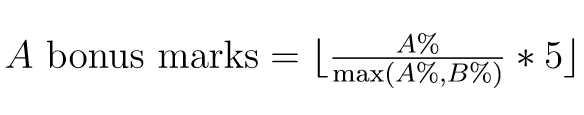
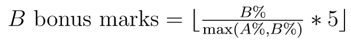
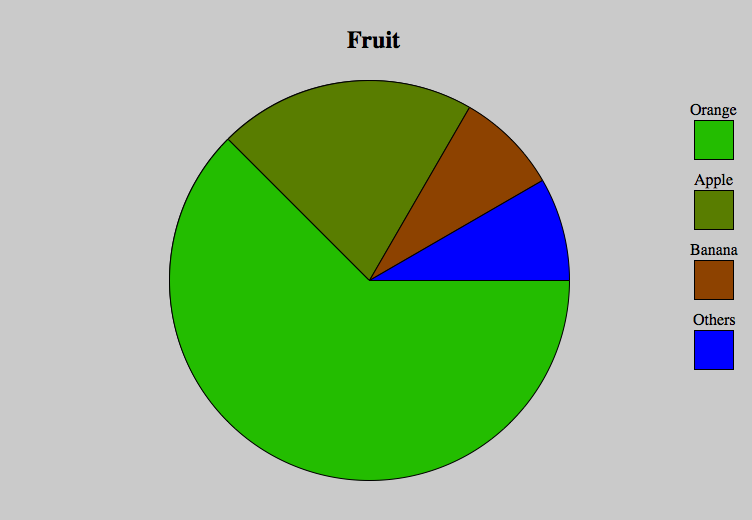
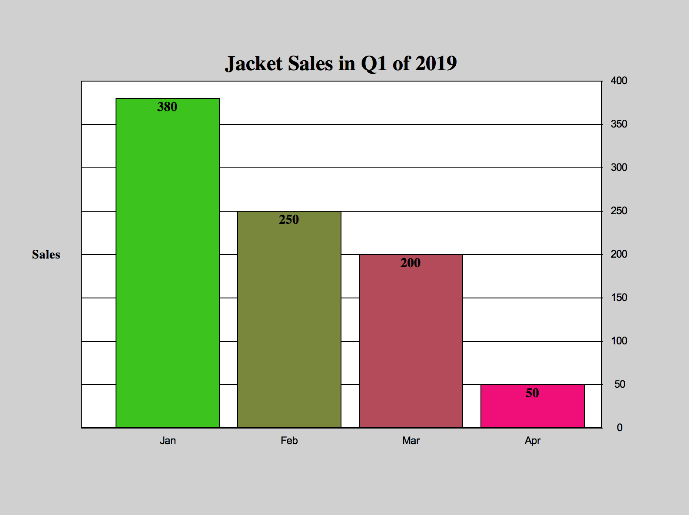

# CPSC 231 Fall 2026 Assignment 2: Multiple Charts

Converted from the [original assignment PDF](./specification.pdf). The PDF remains the authoritative specification. Formatting has been adapted for GitHub; the sample charts and reward-point formulas are preserved as images.

It may become necessary to amend this specification at some point. You will be notified via D2L if that is the case.

**Due Date: Thursday, Oct 15, 2026 @ 23:59**

If the final submission of your assignment is at least 24 hours before the due date, you will receive 5 reward points.

Late submission: -10 marks/day (minimum unit is day); no assignments will be accepted over two days late. You may redeem 10 reward points to remove 1 day late penalty (maximum 2 days for 20 points).

## Overview

This assignment helps you learn if statements and loops. Use the SimpleGraphics library (you can download the library from D2L) to draw either a pie chart or a bar chart. You can work on this assignment individually or in pairs. You can choose your partner, but your partner must register in and attend the same lab as you.

## Policy

Violation of any of the following points is considered academic misconduct.

- You (and your partner) must not submit or look at solutions to the assignment problems that are not your own.
- You (and your partner) must not share your solution code with other students, nor ask others to share their solutions with you (and your partner).
- You (and your partner) must indicate on your submission any assistance received.

## Submission

Submit your Python program (`.py` file) to the dropbox on D2L. Email submissions will NOT be accepted. You should only submit one file that is the Python program and should not include other files. If you are working with a partner, only one of you should do the submission and make sure you add both of your names and student ID numbers in the comment box when you submit your assignment.

If you have any questions regarding the specifications for this assignment or how to submit it, please ask your TA because it is your TA who will mark your assignment. Your TA may also have specific requirements that you should follow.

## Deliverables [Total 140 marks]

### A. Program [70 marks]

Use the SimpleGraphics library to write a Python 3 program that is able to draw a pie chart and a bar chart based on users’ specifications.

Your program must ask the users whether they want a pie chart or a bar chart, receive input from users for drawing the chart type that they chose, and draw the chart according to the specifications that the user gave. You can find sample inputs and charts at the end of this document for an example of each chart and the corresponding inputs.

#### Pie chart requirements

- be roughly in the centre of the window
- has a title
  - centred at the top of the chart, regardless of length
  - the title is decided by the user
- has a diameter between 300 and 500 pixels
- be able to handle from 2 to 6 sectors
  - the specific number of sectors is decided by the user
  - the total value of the pie chart is decided by the user
  - value of each sector is decided by the user, excluding the final sector
    - you can assume the sum of these values does not exceed the total
    - the value of the final sector should be calculated to complete the pie chart
  - each sector must have a name provided by the user
  - each sector must have a unique colour
- has a legend for all of the sectors
  - each legend item includes a box indicating the colour of the sector and the corresponding label of that sector
  - the legend labels and boxes should be positioned such that they do not overlap

#### Bar chart requirements

- be roughly in the centre of the window
- occupies most of the window with margins of about 100 pixels on each side
- has a title
  - centred at the top of the chart
  - the title is decided by the user
- has an x-axis and a y-axis
- has a label on the y-axis
  - positioned to the left of the y-axis, centered vertically
  - the label is decided by the user
- has horizontal gridlines
  - incremental values of the gridlines are decided by the user
  - e.g., user entered 50: gridlines will be on 50, 100, 150, 200, and so on
  - e.g., user entered 20: gridlines will be on 20, 40, 60, 80, and so on
  - values of the gridlines must be displayed on the right side of the chart
- be able to handle 2 to 6 bars
  - value for each bar is decided by the user
    - value must be displayed near the top of the bar
    - you can assume the maximum value for each bar is 400
  - each bar has a label decided by the user
    - the label must be displayed below each corresponding bar

  - the bars must have different colours
  - the bars must be roughly evenly distributed across the x-axis (e.g., if there are only two bars, they cannot be both on the left side of the chart and leave the right side of the chart empty.)

#### Required input order

Your program must ask the user for the following information in the order described below:

- chart type must be the first thing the user enters
- depending on the kind of chart, the user will enter different input
  - for a pie chart
    - title of the chart
    - number of sectors (2 to 6)
    - total value of all sectors combined
    - label of sector 1, value of sector 1, label of sector 2, etc.
    - for the last sector, only ask for the label but not the value (because the program can calculate the value of the last sector based on all of the other information that was given by the user)
  - for a bar chart
    - title of the chart
    - number of bars (2 to 6)
    - horizontal gridline interval (between 10 and 100 inclusively)
    - label for y-axis
    - label of bar 1, value of bar 1, label of bar 2, value of bar 2, etc.
- you can assume there is no error in user input
- you can assume all numbers entered fall within the allowed range(s)

#### Requirements for full marks

For full marks, your program must:

- have information about you (and your partner) in the form of comments at the top of the program, including the rough proportion of the work distributed between you and your partner (if you worked with a partner). For example,

  ```python
  # Name (ID): Arthur Fleck (1357911) and Harley Quinn (246810)
  # Tutorial: 01
  # Arthur Fleck did about 40%. Harley Quinn did about 60%.
  ```

- be properly commented. This means
  - making comments only where code needs further explanation.
  - comment blocks of code to tell us what the blocks do.
  - do not comment every single line of code.
  - comments are formatted and organized in a way that makes them easy to follow.
  - Good example:

    ```python
    # Draw a rectangle
    setOutline("red")
    setFill("light cyan")
    rect(300, 100, 200, 100)
    ```
  - Bad example:

    ```python
    setOutline("red") # draw red outline
    setFill("light cyan") # fill with light cyan
    rect(300, 100, 200, 100) # draw a rectangle
    ```

- have proper code style. This means your code
  - is concise and easy to read without overcomplication,
  - is organized and well thought out,
  - uses meaningful variable names,
  - makes proper use of constants,
    - Note: Because this program may need to have a high number of individual values, some magic numbers (unnamed and/or poorly documented numeric constants without obvious meaning) are allowed. Some constants are still expected, however.
- have proper prompts in the correct order to guide users for inputs.
- apply the appropriate castings to all inputs, with no unnecessary casting.
- use proper loop structure(s) where necessary:
  - for the pie chart,
    - asking for the labels and values of each sector
    - drawing the sectors
    - drawing the legend
  - for the bar chart,
    - asking for the labels and values for each bar
    - drawing the bars and all of their corresponding value/name labels
    - drawing horizontal gridlines and the corresponding gridline values

#### Restrictions

For full marks, your program must not:

- change the default window size created by the SimpleGraphics library.
- ask the user for the colours of the sectors or bars.
- use break or continue commands.
  - if you use break or continue commands, 30 marks will be deducted from the total marks you receive.
- make use of excessive if-statements.
  - if your program has six or more if statement blocks and/or your program exceeds 200 lines without comments, there is a good chance that you have used excessive if-statements. If you’re unsure, ask your TA for clarification.
  - if your program uses excessive if-statements, 30 marks will be deducted from the total marks you receive.
- use loops in an inefficient or inappropriate manner.
  - if your program exceeds 200 lines without comments, there is a good chance you are not using loops properly. If you’re unsure, ask your TA for clarification.
  - if your program uses loops in a manner that is deemed unsuitable, 30 marks will be deducted from the total marks you receive.

#### Design choices

You can decide:

- the font for all the text and values
- the spacing between bars as long as they are roughly evenly spread across horizontally
- the width of the bars, but all bars must have the same width
- whether to have outlines for the bars and sectors as well as the colours for the outlines

- the size of the pie chart as long as the diameter is between 300 and 500 pixels
- location and size of the legend of the pie chart
- exact wording of the prompts
- the colours of the sectors and bars as long as all colours are different.
  - Hint: to ensure all sectors and bars have different colours, it may be easier to use the setFill() function with red, green, and blue values. Please see Section 2.5 and the last example in SG_Basic_Tutorial.pdf for more information.

Refer to the end of this document for sample inputs and charts.

### B. Demo [70 marks]

Done during your lab after the submission deadline.

The specific day(s) dedicated to demoing will take place starting on the first tutorial following submission and continuing until every student has demoed, unless otherwise communicated by your TA. Your TA will be in contact with you about how to schedule your demo during these times. If you have any questions about this, please direct any and all questions to your assigned TAs.

During your assigned demo slot, your TA will ask you to enter specific values as your program inputs, and you will receive marks based on whether or not your output follows expectations. Your TA may also ask you questions about your code.

### C. Partnering [up to 5 reward points]

If you choose to work in a pair, you will be eligible for up to a maximum of 5 reward points (RPs). These points will be distributed according to the rough proportion of the work distributed between you and your partner, as described in the deliverables above.

If students A and B worked together such that A did A% of the work while B did B% of the work, the RPs would be calculated as follows:





For example,

- Uta did about 40%; Shanks did about 60%.
  - Uta would receive 3 RPs while Shanks would receive the maximum 5.
- Both Scott Lang and Hope van Dyne did 50% each.
  - Both Scott Lang and Hope van Dyne would each be awarded 5 RPs.
- Sergio Marquina did 90%; Raquel Murillo did 10%.
  - Sergio Marquina would get the maximum 5 RPs while Raquel Murillo would get 0.

This breakdown must be included in the comment at the top of your program in order for the RPs to be distributed; if the appropriate percentages are not listed, no RPs can be given to either student.

See sample inputs and charts on the next two pages.

## Sample Inputs and Charts

Below are sample prompts presented to the user and the corresponding input (indicated in orange), as well as the resulting pie chart. Your program need not produce output that is identical to the example below. This has been included as a clarifying example only.

### Pie chart example

```text
Chart Creation Menu
  1. Pie Chart
  2. Bar Chart
Select your chart type >> 1
Enter the title of the chart: Fruit
Enter the number of sectors (2 to 6): 4
Enter the total value of all sectors: 240
Label sector 1: Orange
Enter the value of the Orange sector: 150
Label sector 2: Apple
Enter the value of the Apple sector: 50
Label sector 3: Banana
Enter the value of the Banana sector: 20
Label sector 4: Others
Your chart is completed.
```



Below are sample prompts presented to the user and the corresponding input (indicated in orange), as well as the resulting bar chart. Your program need not produce output that is identical to the example below. This has been included as a clarifying example only.

### Bar chart example

```text
Chart Creation Menu
  1. Pie Chart
  2. Bar Chart
Select your chart type >> 2
Enter the title of the chart: Jacket Sales in Q1 of 2019
Enter the number of bars (2 to 6): 4
Enter the gridline interval (10 to 100): 50
Enter the label for the Y-Axis: Sales
Label bar 1: Jan
Enter the value of bar Jan: 380
Label bar 2: Feb
Enter the value of bar Feb: 250
Label bar 3: Mar
Enter the value of bar Mar: 200
Label bar 4: Apr
Enter the value of bar Apr: 50
Your chart is completed.
```


