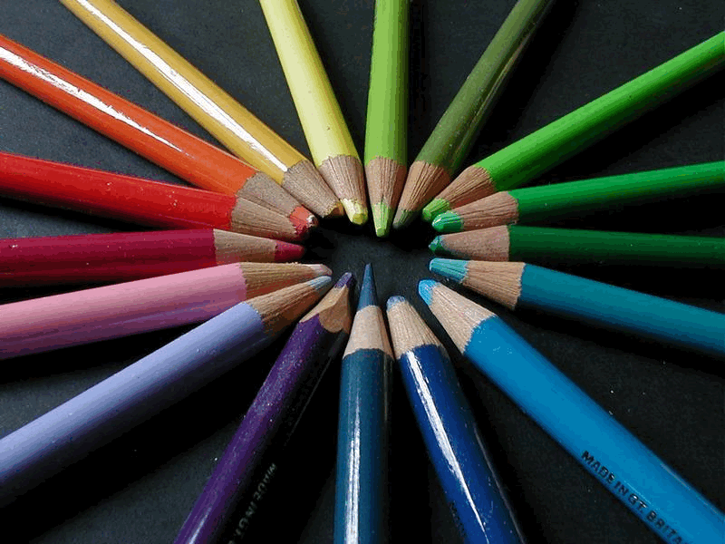
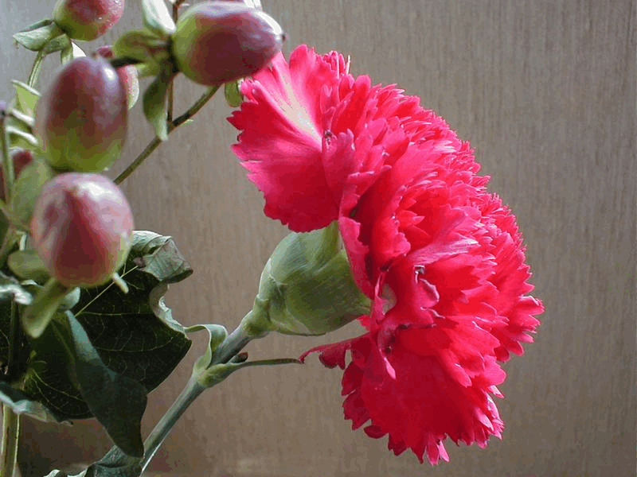
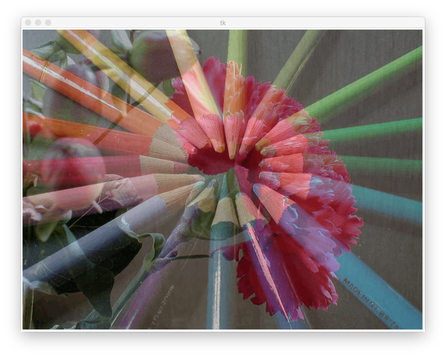
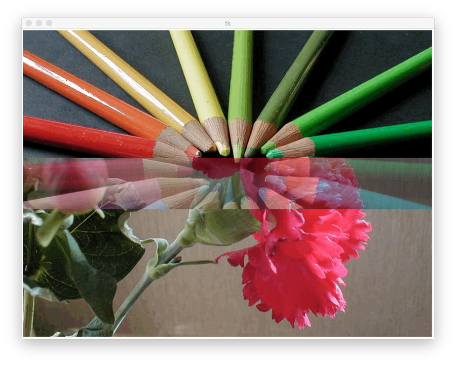
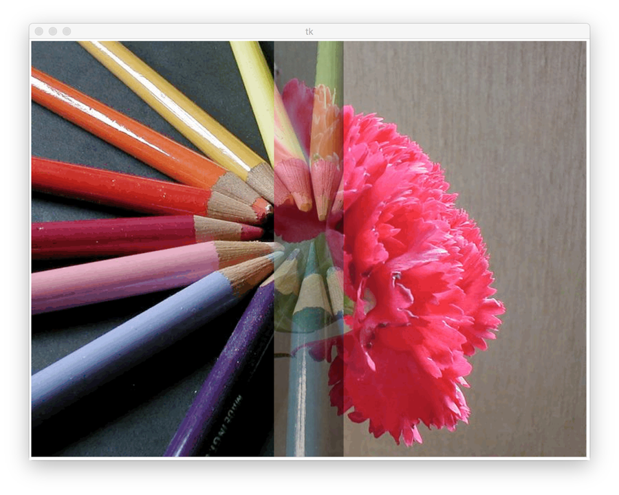
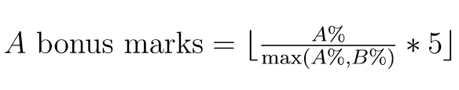
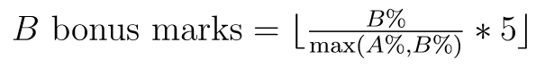

# CPSC 231 Fall 2026 Assignment 3: Image Manipulation

Converted from the [original assignment PDF](./specification.pdf). The PDF remains the authoritative specification. Formatting has been adapted for GitHub; the figures and reward-point formulas are preserved as images.

It may become necessary to amend this specification at some point. You will be notified via D2L if that is the case.

**Due Date: Thursday, Nov 5, 2026 @ 23:59**

If the final submission of your assignment is at least 24 hours before the due date, you will receive 5 reward points.

Late submission: -10 marks/day (minimum unit is day); no assignments will be accepted over two days late. You may redeem 10 reward points to remove 1 day late penalty (maximum 2 days for 20 points).

## Overview

This assignment helps you learn functions and nested loops. Use the SimpleGraphics library (you can download the library from D2L) to combine two images. You can work on this assignment individually or in pairs. You can choose your partner (same or different from before), but your partner must register in and attend the same lab as you.

## Policy

Violation of any of the following points is considered academic misconduct.

- You (and your partner) must not submit or look at solutions to the assignment problems that are not your own.
- You (and your partner) must not share your solution code with other students, nor ask others to share their solutions with you (and your partner).
- You (and your partner) must indicate on your submission any assistance received.

## Submission

Submit your Python program (`.py` file) to the dropbox on D2L. Email submissions will NOT be accepted. You should only submit one file that is the Python program and should not include other files. If you are working with a partner, only one of you should do the submission and make sure you add both of your names and student ID numbers in the comment box when you submit your assignment.

If you have any questions regarding the specifications for this assignment or how to submit it, please ask your TA because it is your TA who will mark your assignment. Your TA may also have specific requirements that you should follow.

## Deliverables [Total 125 marks]

### A. Program [90 marks]

Write a Python 3 program that can combine images in three different ways: combine two whole images, combine parts of the images vertically, and combine parts of the images horizontally.

Figures 1 and 2 show examples of two original images and three different results. You will need to use the SimpleGraphics library in your program for manipulating images. You can find sample inputs and the corresponding output at the end of this document.

| image1.gif | image2.gif |
| --- | --- |
|  |  |

**Figure 1.** Two original images: image1.gif (left) and image2.gif (right).



**Figure 2a.** Combine two whole images.



**Figure 2b.** Combine parts horizontally.



**Figure 2c.** Combine parts vertically.

**Figure 2.** Three different ways to combine images.

#### Required functions

You need to write the following five functions: `handleInput`, `blendPixel`, `combineAll`, `combineParts`, and `main`. These functions should be built as follows:

- `handleInput`: a function that handles user input.
  - Print two prompts that ask the user for the full file names of two .gif images, including the extension. You can assume the user enters the name of a file that exists in the same folder as your program. For example:

    ```text
    Enter the name of the first image: cat.gif
    Enter the name of the second image: dog.gif
    ```

  - Print a nice prompt with choices from 1 to 3 that determine the combination method as follows: 1 for combine all, 2 for a horizontal blend, and 3 for a vertical blend. You need to check if the user input is within the range; if it is not, ask the user to input again until the input is valid. You can assume the user always enters an integer. For example:

    ```text
    Choose one of the following options:
    1 - combine two whole images
    2 - blend horizontally
    3 - blend vertically
    >> 3
    ```

  - This function should take no parameters, but it returns three things: the name of the first image, the name of the second image, and the user's combination choice.
- `blendPixel`: a function that blends two specific pixels from two different images into one single pixel.
  - It should take four parameters: original image 1, original image 2, and the x and y coordinates of the pixels to be blended. The function should return three values: the red, green, and blue values of the resulting pixel. To blend two pixels together, you can take the average values of red, green, and blue values from the original pixels.
- `combineAll`: a function that combines two whole images.
  - It should have two parameters: the two original images. The function should return the image that results from combining the two images entirely (for example, Figure 2a). You will need to use the `blendPixel` function in this function.
- `combineParts`: a function that combines parts of two images.
  - It should have three parameters: the two original images and the option that the user picked (vertical or horizontal). The function should return the resulting image. The resulting image should have a horizontal combined area that is 100 pixels tall (for example, Figure 2b) or a vertical combined area that is 100 pixels wide (for example, Figure 2c). You will need to use the `blendPixel` function in this function.
- `main`: a function that does the high-level work.
  - For example, loading and drawing images should be done here, as well as calling the appropriate functions that you created.

Each function should include a proper function comment, including the purpose of the function, descriptions of all parameters (if no parameters, state no parameters), and descriptions of the return values (if no return values, state no return values).

#### Image information

- You can only use Graphics Interchange Format (GIF with extension .gif) for your images.
  - Simply renaming the image file will not change the image format. For example, changing the file name from image1.jpg to image1.gif would not change the image to GIF file, so the image would not work in your program.
- Both images should be in the same folder as your program.
- You can assume the two original images always have the exact same dimensions.
  - Depending on the image size and computer speed, it may take 5 to 10 seconds (or even more!) to show the final image.

**Important:** Some sample images have been provided on D2L.

- These images are provided in groups of like-sized images as follows:
  - Test 1: Test1_a.gif, Test1_b.gif
  - Test 2: Test2_a.gif, Test2_b.gif

  For example, Test1_a.gif and Test1_b.gif can be combined, but Test1_a.gif and Test2_a.gif cannot because they are not the same size.
- You can assume images for the demo are located in the same folder as your .py file.

#### Marking information

Your program must meet the following requirements:

- Call the `main` function to start the program logic.
  - The only lines of code that should appear outside of any functions are import statements, constants (if any) and the call to the `main` function.
- Have all five functions, with the exact structure and design as described above, and make appropriate use of them.
- Have a strip of exactly 100 pixels in height/width for the partially combined images (see Figure 2b and Figure 2c above).
- Resize the output window to the size of the original images. Note that this requirement is different from your previous assignments.

For full marks, your program must:

- have information about you (and your partner) in the form of comments at the top of the program, including the rough proportion of the work distributed between you and your partner (if you worked with a partner). For example,

  ```python
  # Name (ID#): Irene Adler (1357911) and James Moriarty (246810)
  # Tutorial: 01
  # Irene Adler did about 40%. James Moriarty did about 60%.
  ```

- have proper comments. This means
  - making comments only where code needs further explanation.
  - comment blocks of code to tell us what the blocks do.
  - do not comment every single line of code.
  - comments are formatted and organized in a way that makes them easy to follow.
  - Good example:

    ```python
    # Draw a rectangle
    setOutline("red")
    setFill("light cyan")
    rect(300, 100, 200, 100)
    ```
  - Bad example:

    ```python
    setOutline("red") # draw red outline
    setFill("light cyan") # fill with light cyan
    rect(300, 100, 200, 100) # draw a rectangle
    ```

- have proper coding style. This means your code
  - is concise and easy to read without overcomplication,
  - is organized and well thought out with appropriate white space,
  - uses meaningful variable names,
  - makes proper use of constants.
- make appropriate use of loops, if-statements, and functions.
- meet all requirements listed in the assignment description.

For full marks, your program must not:

- define one function inside of another function.
- use any libraries other than the SimpleGraphics library.
- use lists. Lists are unnecessary in this assignment, and using them will only complicate your program and make it more difficult to write and understand.
- change the parameter(s) and/or return value(s) of the functions as specified above.
- behave unexpectedly or crash due to non-user-input errors.

Each of the following may result in a 30 mark deduction from your total grade:

- using global variables (note that global constants are fine)
- using `break` or `continue` commands
- having more than one `return` statement in a function

#### Useful functions

Comments and function definitions are shown below (extracted from SimpleGraphics.py). Note that you may use these provided function comments as an example for building your own; however, you may also structure your function comments similar to the way shown in lectures.

```python
## Create a new image by loading an image file in .gif or .ppm format
# @param fname: the name of the file to load
# @return a new image object loaded with the data from the file
def loadImage(fname):

## Draw the provided image with its upper left corner at (x, y)
# @param img: the image to display
# @param x: the x position of the upper left corner
# @param y: the y position of the upper left corner
# @return (None)
def drawImage(img, x, y):

## Create a new blank image
# @param w: the width of the created image
# @param h: the height of the created image
# @return a new image object
def createImage(w, h):

## Get the height of the window or an image
# @param the image to examine, or None which indicates that the height
#        of the window should be returned
# @return the height
def getHeight(what=None):

## Get the width of the window or an image
# @param the image to examine, or None which indicates that the width
#        of the window should be returned
# @return the width
def getWidth(what=None):

## Retrieve the red, green and blue components of a pixel in an image
# @param img: the image to retrieve the pixel from
# @param x: the x position of the pixel that will be retrieved
# @param y: the y position of the pixel that will be retrieved
# @return a tuple containing the red, green and blue values
def getPixel(img, x, y):

## Write a pixel into an image
# @param img: the image to modify
# @param x: the x position that will be modified
# @param y: the y position that will be modified
# @param r: the red component of the new pixel color
# @param g: the green component of the new pixel color
# @param b: the blue component of the new pixel color
# @return (None)
def putPixel(img, x, y, r, g, b):

## Resize the window to a specific size in pixels
# @param w: the new window width
# @param h: the new window height
def resize(w, h):
```

### B. Demo [35 marks]

Done during your lab after the submission deadline.

The specific day(s) dedicated to demoing will take place starting on the first tutorial following submission and continuing until every student has demoed, unless otherwise communicated by your TA. Your TA will be in contact with you about how to schedule your demo during these times. If you have any questions about this, please direct any and all questions to your assigned TAs.

During your assigned demo slot, your TA will ask you to enter specific values as your program inputs, and you will receive marks based on whether or not your output follows expectations. Your TA may also ask you questions about the behaviour of your code based on different input values.

### C. Partnering [up to 5 bonus marks]

If you choose to work in a pair, you will be eligible for up to a maximum of 5 reward points (RPs). These points will be distributed according to the rough proportion of the work distributed between you and your partner, as described in the deliverables above.

If students A and B worked together such that A did A% of the work while B did B% of the work, the RPs would be calculated as follows:





For example,

- Uta did about 40%; Shanks did about 60%.
  - Uta would receive 3 RPs while Shanks would receive the maximum 5.
- Both Scott Lang and Hope van Dyne did 50% each.
  - Both Scott Lang and Hope van Dyne would each be awarded 5 RPs.
- Sergio Marquina did 90%; Raquel Murillo did 10%.
  - Sergio Marquina would get the maximum 5 RPs while Raquel Murillo would get 0.

This breakdown must be included in the comment at the top of your program in order for the RPs to be distributed; if the appropriate percentages are not listed, no RPs can be given to either student.

## Sample Inputs and Output

Below are sample prompts presented to the user and the corresponding input, as well as the resulting image. Your program need not produce prompts that are identical to the example below; this has been included as a clarifying example only.

```text
Enter the name of the first image: image1.gif
Enter the name of the second image: image2.gif

Choose one of the following options:
1 - combine two whole images
2 - blend horizontally
3 - blend vertically
>> 5

Please enter 1, 2, or 3:
1 - combine two whole images
2 - blend horizontally
3 - blend vertically
>> 0

Please enter 1, 2, or 3:
1 - combine two whole images
2 - blend horizontally
3 - blend vertically
>> 2
```


## Status

Specification added October 26, 2026. No solution code is included. See the [assignment index](../README.md) and [course outline summary](../../course-outline.md).
